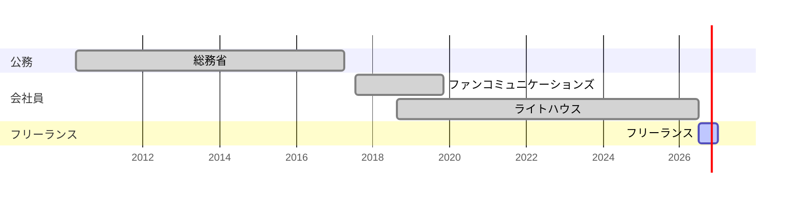

# 職務経歴書

**フルスタックエンジニア / フリーランス**

インフラ · バックエンド · フロントエンド · IoT · データ分析

---

## 🙋‍♂️ はじめに

フルスタックに大体なんでもいけます。

| 領域 | 内容 |
| :-- | :-- |
| ☁️ インフラ | AWS（Terraform / Serverless / ECS / Lambda） |
| ⚙️ バックエンド | Go / Python / Ruby / PHP / Scala |
| 🖥️ フロントエンド | Web（React / Vue / Nuxt）、Android |
| 📊 データ分析 | BigQuery / Redash / MWAA / Jupyter |

> カチカチに凝り固まった技術的負債をなんとかし、**心理的安全性を持って継続的にデプロイできる状態**をつくることばかりやっています。

## ✨ ハイライト

- 💰 **AWSコストを月額 $13,500 → $7,000 へ、無事故で半減**（DynamoDB 10TB / S3 170TB の永続化データ退避ほか）
- 📡 **数百台規模のIoTデバイスのアップデート基盤を構築**（コード管理すらされていない状態から）
- 📱 **外注していたAndroidアプリを一人で内製化**
- 🏗️ **Terraform によるAWSインフラ全般の構築と、マイクロサービスごとのCI/CD整備**

## 📚 スキル

## 📆 年表

---

## 📰 職務経歴

### 🧑‍💻 フリーランス

| | |
| :-- | :-- |
| **職種** | フルスタックエンジニア |
| **期間** | 2026年7月〜現在 |
| **業務** | <!-- TODO: 案件内容を記入 --> |

<!-- TODO: 参画案件・担当内容・使用技術を記入 -->

---

### 🚢 株式会社ライトハウス

| | |
| :-- | :-- |
| **職種** | エンジニア |
| **期間** | 2018年8月〜2019年10月（業務委託） 2019年11月〜2026年6月（社員） |
| **業務** | 漁業者向けの船舶プラットフォームの開発 |
| **リンク** | [公式サイト](https://lighthouse-frontier.tech/) · [YouTube](https://www.youtube.com/@lighthouseofficial6978) · [技術ブログ：ISANAの開発について](https://developers.lighthouse-frontier.tech/entry/2020/06/06/103609) |

#### 💰 コスト削減

AWSコストを **月額 $13,500 → $7,000** まで無事故で削減。

- 肥大化した永続化データを別のS3バケットへ退避
  - DynamoDB：GPSデータなど **10TB / 200億レコード**
  - S3：画像データなど **170TB / 130億オブジェクト**
- Auto Scaling の調整
- CloudWatch Logs の S3 Export・保存期間の調整
- ECS の Spot Instance 化
- S3 Lifecycle Policy の設定
- RDBアクセス用 Bastion の CloudShell 化

#### 📡 IoT（海上で動作する Raspberry Pi 上のアプリケーション）

`Python` `Go`

- 数百台規模のIoTデバイスのプログラムのアップデート基盤を構築
  - コード管理すらされていない状況からスタート
- ログを低コストでサーバー側にアップロードする仕組みを構築
  - 電源OFFの状態でもログによる調査が可能に
- 圏外時のデータを端末に保存し、電波がある時に送信する仕組みを構築

#### ☁️ インフラ・CI/CD・運用

`Terraform` `Serverless Framework` `AWS Lambda` `Datadog`

- [Terraform](https://www.terraform.io/) を用いたAWSインフラ全般の構築
- [Serverless](https://www.serverless.com/) を用いた AWS Lambda の構築（Python / Go）
- マイクロサービスごとに CI/CD を構築
  - Terraform の差分を Daily でチェックする仕組み
  - Security Test を Daily で回す仕組み
- モニタリング環境の構築・メンテナンス（Datadog）

#### ⚙️ API開発

`Ruby on Rails` `Go (Gin / gRPC)` `Python (FastAPI)` `ECS` `API Gateway`

#### 🖥️ フロントエンド開発

| 対象 | 技術 |
| :-- | :-- |
| エンドユーザ向けGISフロントエンド | `TypeScript` `React` `Vite` |
| 社内向け管理画面 | `JavaScript` `Vue.js` `Nuxt.js` |
| 社内向けスクレイピングツール | `TypeScript` `Vue.js` `Nuxt.js` `Python (FastAPI)` |

#### 📱 Androidアプリの内製化

- 担当者の変遷などで外注先がバグ修正できなくなったことを契機に、自身で一から巻き取り

#### 📊 社内向け分析基盤

`BigQuery` `MWAA` `Lambda` `Redash` `ECS`

- BigQuery へのデータ export
- バッチの作成（MWAA / Lambda）
- ECS による Redash の構築
- クエリ・ダッシュボードの作成

#### 🤝 その他

- 業務委託エンジニアとの調整

---

### 📢 株式会社ファンコミュニケーションズ

| | |
| :-- | :-- |
| **職種** | エンジニア |
| **期間** | 2017年7月〜2019年10月 |
| **業務** | 広告配信プラットフォームの開発 |

| 担当 | 技術 |
| :-- | :-- |
| 広告配信用の社内管理ツールのWebサービス開発 | `CakePHP2` `jQuery` `MySQL` |
| 広告配信基盤の開発 | `Scala` |
| 広告配信データの分析・機械学習 | `Python` `Jupyter Notebook` `Treasure Data` |

---

### 🏛️ 総務省

| | |
| :-- | :-- |
| **職種** | 行政官 |
| **期間** | 2010年4月〜2017年3月 |
| **業務** | 事務一般 |

- 固定通信市場（固定電話・光ファイバー市場）における競争環境の整備
- モバイル通信市場（格安SIM市場）における競争環境の整備
- 法案制定業務、法令審査業務、訴訟対応業務 等
- 4K・8K放送の国際展開業務、衛星放送事業者に対する許認可業務、衛星放送事業の収支統計業務、予算関係業務、海外法令の調査業務

---

## 🎨 趣味プロダクト

- [**Emoojie**](https://emoojie.web.app/) — 絵文字を簡単に生成・Slack登録できるツール

## 🐞 その他

> **ポリシー**：違和感は信じる。直感は疑う。

**アイコン**：てんとう虫はアブラムシ（bug）を食べる虫。「バグが減りますように」という願掛け。
